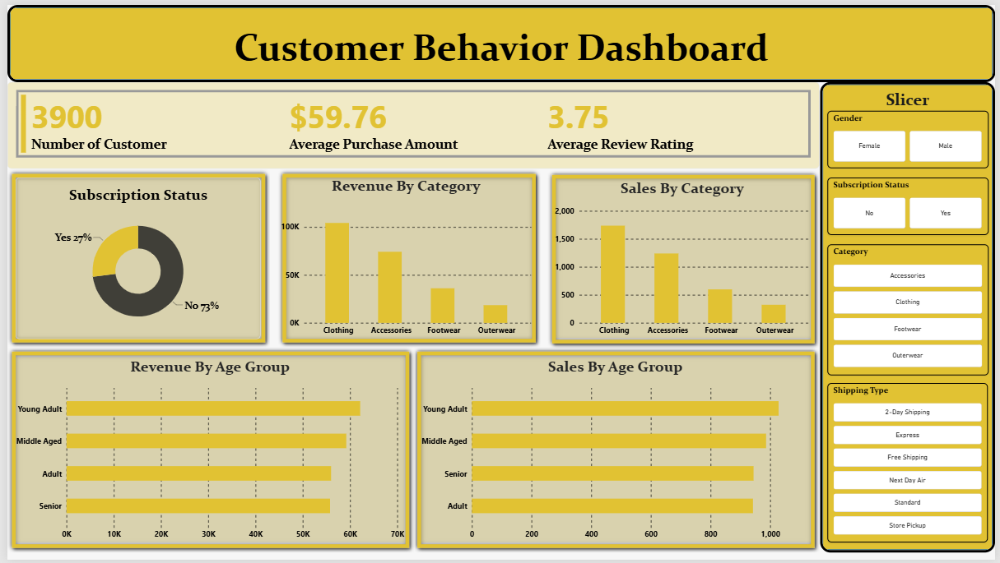

# Customer Shopping Behavior Analysis

An end-to-end data analytics project exploring customer purchasing patterns, product preferences, discount behaviour, subscription trends, and revenue distribution using Python, PostgreSQL, SQL, and Power BI.

---

## Project Overview

Understanding customer shopping behaviour helps businesses improve customer experience, optimise marketing strategies, and make better data-driven decisions.

In this project, I analysed customer shopping transaction data to identify purchasing patterns, understand customer segments, evaluate discount usage, and explore subscription behaviour.

The project combines Python for data cleaning and exploratory data analysis, PostgreSQL for business-focused SQL analysis, and Power BI for presenting insights through an interactive dashboard.

## Business Objectives

The main objectives of this project are:

- Analyse revenue distribution across customer demographics.
- Identify customers who use discounts but still make high-value purchases.
- Evaluate product ratings and purchasing preferences.
- Compare purchasing behaviour across different shipping methods.
- Understand spending patterns of subscribers and non-subscribers.
- Identify products with a high proportion of discounted purchases.
- Segment customers based on their previous purchase history.
- Identify the most frequently purchased products within each category.
- Examine repeat-purchase records across subscription status.
- Analyse revenue contribution across different age groups.

---

## Dataset Overview

The dataset contains **3,900 purchase records and 18 columns** covering customer demographics, product information, and shopping behaviour.

| Category | Information |
|---|---|
| Customer Demographics | Age, Gender, Location |
| Purchase Details | Item Purchased, Category, Purchase Amount |
| Shopping Behaviour | Discount Applied, Promo Code Used, Previous Purchases |
| Product Information | Size, Color, Season, Review Rating |
| Delivery Information | Shipping Type |
| Subscription Information | Subscription Status |

**Missing Values:** The dataset contains 37 missing values in the Review Rating column.

---

## Tools & Technologies

| Technology | Purpose |
|---|---|
| Python | Data cleaning and exploratory data analysis |
| Pandas | Data manipulation and preprocessing |
| NumPy | Numerical operations |
| Matplotlib | Data visualisation |
| Seaborn | Statistical visualisation |
| PostgreSQL | Database management |
| SQL | Business analysis and data extraction |
| Power BI | Interactive dashboard development |
| Jupyter Notebook | Python development environment |

---

## Project Workflow

### 1. Data Loading & Exploratory Data Analysis

The dataset was imported into Python using Pandas. Initial exploration was performed to understand the dataset structure, identify missing values, inspect data types, and examine descriptive statistics.

Key activities:

- Loaded the dataset using Pandas.
- Inspected dataset structure using `info()`.
- Generated descriptive statistics using `describe()`.
- Checked missing values and duplicate records.
- Explored customer demographics and purchase-related variables.

### 2. Data Cleaning & Feature Engineering

Data preparation was performed to improve data consistency and make the dataset suitable for further analysis.

Key activities:

- Handled missing Review Rating values using the median rating within each product category.
- Standardised column names into `snake_case` format.
- Created an `age_group` column by grouping customers into age categories.
- Created a `purchase_frequency_days` column by converting purchase-frequency labels into approximate day values.
- Checked the relationship between `discount_applied` and `promo_code_used`.
- Removed the redundant `promo_code_used` column from the prepared dataset.

### 3. Database Integration (PostgreSQL)

After cleaning and preparing the data, the dataset was loaded into PostgreSQL for structured querying and business analysis.

PostgreSQL was used to perform aggregations, filtering, comparisons, customer segmentation, and product-level analysis.

### 4. Business Analysis Using SQL

I developed SQL queries to investigate the following business questions:

| No. | Business Question | SQL Concepts |
|---|---|---|
| 1 | What is the total revenue generated by male vs. female customers? | GROUP BY, SUM |
| 2 | Which customers used a discount but still spent more than the average purchase amount? | WHERE, Subquery, AVG |
| 3 | Which are the top 5 products with the highest average review ratings? | GROUP BY, AVG, ORDER BY |
| 4 | How do average purchase amounts compare between Standard and Express shipping? | WHERE, GROUP BY, AVG |
| 5 | Do subscribed customers spend more? | GROUP BY, COUNT, AVG, SUM |
| 6 | Which 5 products have the highest percentage of purchases with discounts applied? | CASE WHEN, SUM, COUNT |
| 7 | How can customers be segmented into New, Returning, and Loyal groups? | CTE, CASE WHEN |
| 8 | What are the top 3 most purchased products within each category? | CTE, Window Functions, ROW_NUMBER |
| 9 | How are customers with more than 5 previous purchases distributed across subscription status? | WHERE, GROUP BY, COUNT |
| 10 | What is the revenue contribution of each age group? | GROUP BY, SUM, ORDER BY |

**SQL Skills Demonstrated:**

- Data filtering and sorting
- Aggregate functions
- GROUP BY and HAVING
- Subqueries
- CASE statements
- Common Table Expressions (CTEs)
- Window functions
- Ranking and segmentation
- Business-focused data analysis

### 5. Power BI Dashboard

An interactive dashboard was developed using Power BI to present important customer shopping metrics and analytical findings.

The dashboard provides a consolidated view of customer and purchase behaviour through visualisations.

### Dashboard Preview



**Power BI File:** `dashboard/Customer_Shopping_Behavior_Analysis_PowerBI.pbix`

The interactive dashboard can be opened using Power BI Desktop.

---

## Key Business Recommendations

Based on the areas investigated in this project, the following business recommendations can be considered:

**1. Improve Subscription Engagement**

Analyse differences between subscribers and non-subscribers and develop targeted subscription benefits to encourage customer retention.

**2. Optimise Discount Strategies**

Identify products with high discount usage and evaluate whether discounts are supporting purchasing activity without unnecessarily reducing margins.

**3. Strengthen Customer Loyalty**

Use purchase-history segments to design suitable loyalty programmes and encourage repeat purchases.

**4. Improve Product Positioning**

Use product ratings and purchase frequency to identify products that could receive greater promotional attention.

**5. Develop Targeted Marketing Campaigns**

Use demographic and age-group analysis to create more relevant marketing campaigns for different customer segments.

---

## Repository Structure

```text
Customer-Shopping-Behavior-Analysis/
│
├── data/
│   └── customer_shopping_behavior.csv
│
├── notebooks/
│   └── Customer_Shopping_Behavior_Analysis.ipynb
│
├── sql/
│   └── customer_shopping_behavior.sql
│
├── dashboard/
│   ├── Customer_Shopping_Behavior_Analysis_PowerBI.pbix
│   └── Dashboard.png
│
├── reports/
│   └── Customer_Shopping_Behavior_Analysis_Professional_Report_Layout_Fixed.pdf
│
├── README.md
├── requirements.txt
└── .gitignore
```

---

## How to Run This Project

### Prerequisites

Make sure you have the following installed:

- Python 3.9 or later
- Jupyter Notebook
- PostgreSQL
- pgAdmin or another PostgreSQL client
- Power BI Desktop

### Step 1: Clone the Repository

```bash
git clone https://github.com/Abhishek-Bandwal/Customer-Shopping-Behavior-Analysis.git
```

Move into the project directory:

```bash
cd Customer-Shopping-Behavior-Analysis
```

### Step 2: Install Dependencies

Install the required Python libraries:

```bash
pip install -r requirements.txt
```

### Step 3: Configure the Dataset

The dataset is available in the `data/` directory.

Expected filename:

```text
customer_shopping_behavior.csv
```

### Step 4: Run the Jupyter Notebook

Open Jupyter Notebook:

```bash
jupyter notebook
```

Navigate to the `notebooks/` directory and open the analysis notebook.

Run the cells in sequence to perform data loading, cleaning, exploratory analysis, feature engineering, and database integration.

### Step 5: Connect to PostgreSQL

Create a PostgreSQL database and configure the database connection in the notebook.

Use environment variables for database credentials. Do not store passwords directly in the notebook or upload them to GitHub.

### Step 6: Execute SQL Queries

Open the SQL file inside the `sql/` directory.

Connect to your PostgreSQL database and execute the queries to reproduce the business analysis.

### Step 7: View the Power BI Dashboard

Open the following file using Power BI Desktop:

`dashboard/Customer_Shopping_Behavior_Analysis_PowerBI.pbix`

Explore the dashboard to review customer shopping metrics and analytical findings.

---

## Limitations & Considerations

- The analysis is based on the available dataset and represents patterns within the provided purchase records.
- Customer segmentation depends on the previous-purchase thresholds defined in the SQL queries.
- The repeat-buyer query counts records with more than five previous purchases by subscription status. This count alone does not establish whether repeat buyers are more likely to subscribe.
- Business recommendations are based on observed patterns and should be validated with additional business and financial information before implementation.
- SQL outputs and dashboard figures should be checked against the final versions of the queries before publication.

---

## Author

**Abhishek Bandwal**

MBA – Business Analytics & Operations  
B.Tech – Information Technology

**Areas of Interest:** Business Analysis | Data Analytics | Business Intelligence | Data-Driven Decision Making

---

If you found this project useful, feel free to explore the repository and share your feedback.
